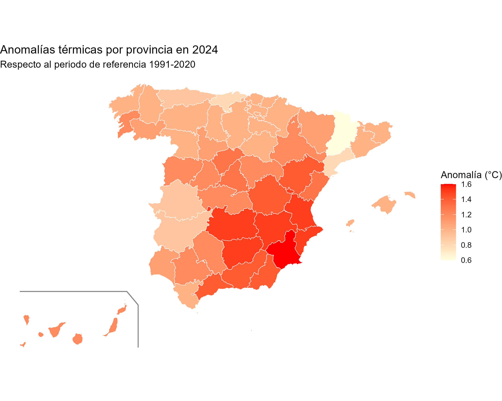
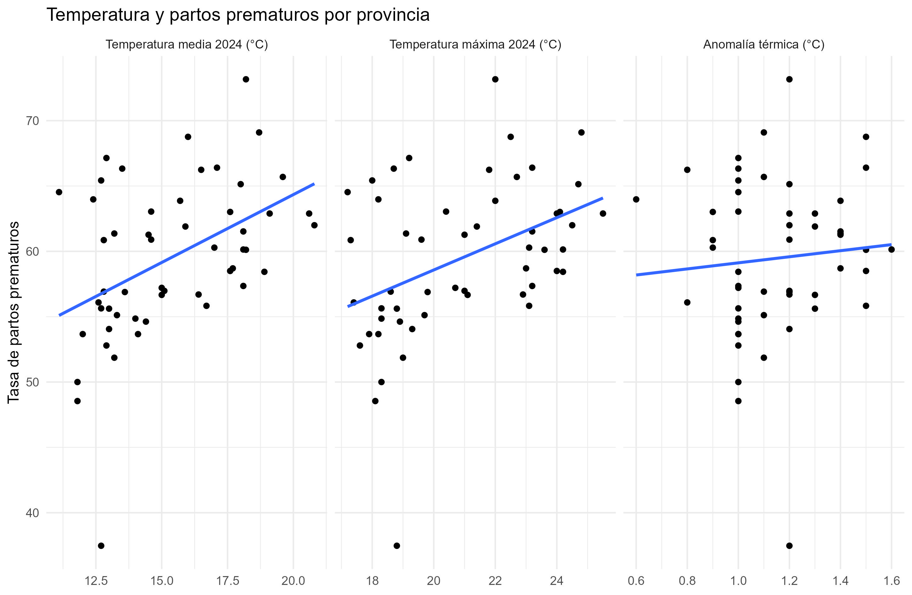

  
  

 

# Temperaturas extremas y complicaciones durante el embarazo en España

# Calor y complicaciones durante el embarazo

**Seminario de Fuentes de Datos Biomédicos y Web Semántica**

Universidad de Burgos - Grado en Ingeniería de la Salud

Curso 2026-2027

## Descripción del seminario

En este seminario analizamos las temperaturas registradas en las provincias españolas durante 2024 y exploramos su posible relación con diferentes indicadores relacionados con el embarazo como los aprtos prematuros, la mortalidad fetal tardía y la mortalidad perinatal.

Para ello, utilizamos datos metereológicos y sanitarios de fuentes oficiales, los cuales han sido procesados y representados mediante el lenguaje R.

## Objetivos

- Analizar las diferencias de temepratura entre las provincias españolas durante 2024.
- Comparar las temepraturas medias de 2024 con las del periodo de 1991 a 2020.
- Estudiar la distribución provincial de los indicadores relacionados con el embarazo.
- Explorar posibles relaciones entre los datos sanitarios y los datos meterelógicos analziados.

## Resultados

Los resultados se presentan mediante gráficos y mapas que permiten visualizar las diferencias entre provincias.

<table width="100%">
  <tr>
    <td align="center" width="50%">
      <strong>Anomalías térmicas en 2024</strong>
    </td>
    <td align="center" width="50%">
      <strong>Temperatura y partos prematuros</strong>
    </td>
  </tr>
  <tr>
    <td align="center">
      
    </td>
    <td align="center">
      
    </td>
  </tr>
</table>

## Conclusiones

A lo largo del año 2024 se observaron anomalías térmicas positivas en las provincias españolas. Sin embargo, la comparación visual con los indicadores de mortalidad fetal tardía y perinatal no muestra una coincidencia geográfica clara.

Estos resultados deben interpretarse con precaución, ya que el análisis se limita a un año y utiliza datos agregados por provincias, por lo que no permite establecer relaciones causales.

## Estructura del repositorio

- `INPUT/`: archivos con los datos utilizados en el análisis.
- `OUTPUT/`: resultados y gráficos generados.
- `scripts/`: código y documento R Markdown del seminario.
- `README.md`: descripción general del proyecto.

## Autores

Rebeca Ojer Aransáez, Nicolás Planas García y Milagros Varela San.